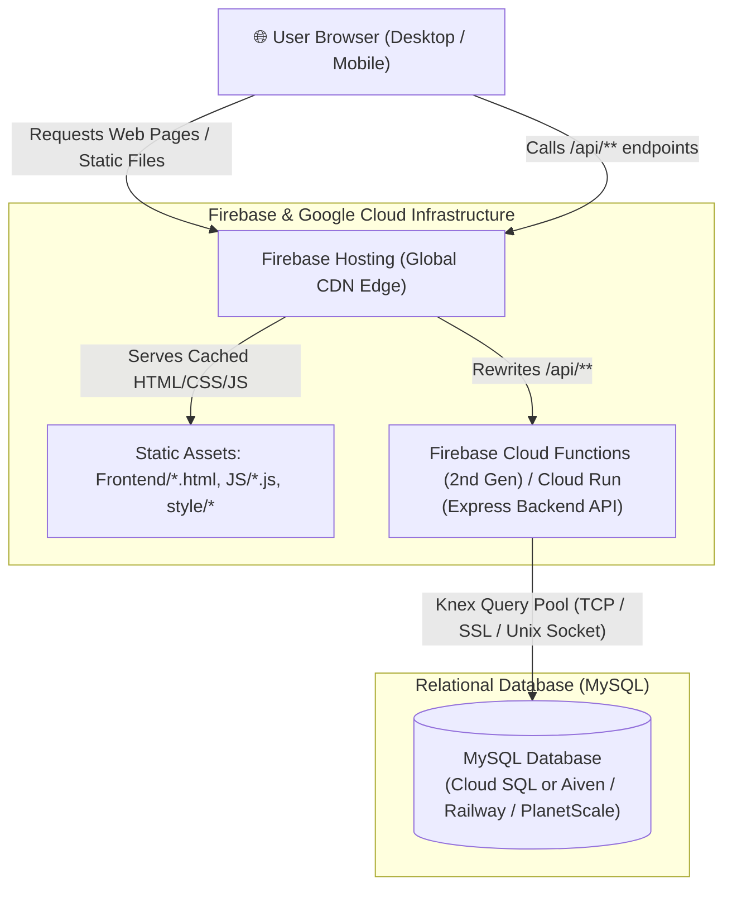

# 🚀 PUP PQ-Scheduler: Firebase Deployment Guide

This guide walks you through deploying the **PUP PQ-Scheduler (Academic Workload Management System)** to **Firebase**.

---

## 🏗️ 1. Architecture Overview

Because this system is a full-stack Node.js + Express application with a relational MySQL database, the deployment architecture is split into three coordinated layers:



| Layer | Service | Purpose |
| :--- | :--- | :--- |
| **Frontend** | **Firebase Hosting** | Delivers HTML pages, stylesheets, images, and client JS from Google's global CDN with automated HTTPS. |
| **Backend API** | **Firebase Cloud Functions (2nd Gen)** | Runs the Express server (`index.firebase.js` wrapping `server.js`) on demand, autoscaling from 0 to 10 instances. |
| **Database** | **Google Cloud SQL or Managed Cloud MySQL** | Hosts the 11 relational tables (`pup_workload`). *Note: Firebase's native Firestore is NoSQL, so relational MySQL runs in Google Cloud SQL or a managed cloud MySQL provider.* |

---

## 📋 2. Prerequisites & Initial Setup

### Step 2.1: Install Firebase CLI
Open PowerShell or Command Prompt on your computer and install the Firebase CLI globally:

```powershell
npm install -g firebase-tools
```

Verify the installation:
```powershell
firebase --version
```

### Step 2.2: Log in to Firebase
Authenticate your Google Account with the Firebase CLI:

```powershell
firebase login
```
*(A browser window will open asking you to sign in with your Google account).*

### Step 2.3: Create a Project in Firebase Console
1. Navigate to the [Firebase Console](https://console.firebase.google.com/).
2. Click **Add project** (or **Create a project**).
3. Name your project (e.g., `pup-pq-scheduler` or `pupwms-production`).
4. Disable Google Analytics (optional, for simplicity) and click **Create Project**.
5. Upgrade the project to the **Blaze (Pay as you go)** plan.
   > [!NOTE]
   > Firebase Cloud Functions (2nd Gen) and outgoing network calls (connecting to a database or SMTP email dispatcher) require the **Blaze plan**. Firebase includes a generous free tier every month (2M function invocations, 10 GB hosting storage, 360,000 GB-seconds compute free per month), so a university system will typically cost **$0.00** during normal use.

---

## 🗄️ 3. Setting Up the MySQL Database

Choose **Option A** (Free / Quick Managed MySQL) or **Option B** (Official Google Cloud SQL):

### Option A: Free Cloud MySQL (Recommended for Easy Setup)
You can use a free cloud MySQL provider like [Aiven for MySQL](https://aiven.io/), [Railway](https://railway.app/), or [Supabase](https://supabase.com/):
1. Sign up and create a new **MySQL 8.0** database named `pup_workload`.
2. Copy your connection parameters:
   - Host (e.g. `mysql-xyz.aivencloud.com`)
   - Port (e.g. `12345` or `3306`)
   - User (e.g. `avnadmin` or `root`)
   - Password
3. Import the existing schema by running your local `schema.sql`:
   ```powershell
   mysql -h your-host -P your-port -u your-user -p pup_workload < schema.sql
   ```

### Option B: Google Cloud SQL for MySQL (Enterprise GCP Integration)
1. In the Google Cloud Console for your Firebase project, go to **SQL** > **Create Instance**.
2. Select **MySQL 8.0**.
3. Choose the instance region (e.g., `asia-southeast1` for Singapore, closest to Manila).
4. Create a database named `pup_workload`.
5. Import `schema.sql` via Cloud Storage or Cloud Shell.
6. Note your instance connection name: `PROJECT_ID:REGION:INSTANCE_NAME`.

---

## ⚙️ 4. Project Configuration Files Ready in Workspace

The following configuration files have already been prepared in your project root:

1. [firebase.json](file:///c:/Users/nhico/Downloads/Pupwms2_Casptone_updating/firebase.json) — Routes `/api/**` to Cloud Functions and serves `public/` via Firebase Hosting.
2. [index.firebase.js](file:///c:/Users/nhico/Downloads/Pupwms2_Casptone_updating/index.firebase.js) — Exports your Express server as a 2nd Gen HTTPS function (`api`) in `asia-southeast1`.
3. [prepare-public.js](file:///c:/Users/nhico/Downloads/Pupwms2_Casptone_updating/prepare-public.js) — Bundles all HTML pages, scripts, and stylesheets into the `public/` directory.
4. [config/database.js](file:///c:/Users/nhico/Downloads/Pupwms2_Casptone_updating/config/database.js) — Updated to automatically support Cloud SQL Unix Sockets, Remote Cloud MySQL with SSL, and local development.
5. [.firebaserc](file:///c:/Users/nhico/Downloads/Pupwms2_Casptone_updating/.firebaserc) — Project identifier alias.

---

## 🚀 5. Deployment Step-by-Step

### Step 5.1: Link Your Project
In your project root terminal, run:

```powershell
firebase use --add
```
Select the Firebase project ID you created in Step 2.3, and give it the alias `default`.

### Step 5.2: Configure Environment Variables
Set your production database and email credentials for Cloud Functions using Firebase environment secrets:

```powershell
# If using Option A (Cloud MySQL):
firebase functions:secrets:set DB_HOST
firebase functions:secrets:set DB_PORT
firebase functions:secrets:set DB_USER
firebase functions:secrets:set DB_PASSWORD
firebase functions:secrets:set DB_NAME
firebase functions:secrets:set DB_SSL

# Email credentials (if keeping the dedicated Gmail dispatcher):
firebase functions:secrets:set SMTP_USER
firebase functions:secrets:set SMTP_PASS
```
*(Alternatively, create a `.env` file in the functions environment or pass them via Google Cloud Run Configuration).*

### Step 5.3: Build the Static Assets
Run the build script to prepare the `public/` folder:

```powershell
npm run build:public
```

### Step 5.4: Deploy to Firebase!
Deploy everything (Hosting + Cloud Functions) with a single command:

```powershell
firebase deploy
```

If you only want to update the frontend:
```powershell
firebase deploy --only hosting
```

If you only want to update the backend:
```powershell
firebase deploy --only functions
```

---

## 🔍 6. Post-Deployment Verification Checklist

- [ ] **Hosting URL**: Open the deployed URL provided in the console (e.g. `https://your-project.web.app/`).
- [ ] **Login Test**: Test signing in with `Academic_Head@pupwms.com` or default admin accounts.
- [ ] **API Rewrites**: Inspect the Network tab in DevTools to confirm requests to `/api/initial-state` and `/api/faculty` return HTTP 200.
- [ ] **Email Dispatcher**: Trigger a test workload notification to verify Nodemailer routes through the Cloud Function.
- [ ] **Custom Domain (Optional)**: In Firebase Console > **Hosting** > **Add Custom Domain**, you can connect your university domain (e.g. `scheduler.pup-paranaque.edu.ph`). Firebase automatically provisions and renews SSL certificates at no cost.
