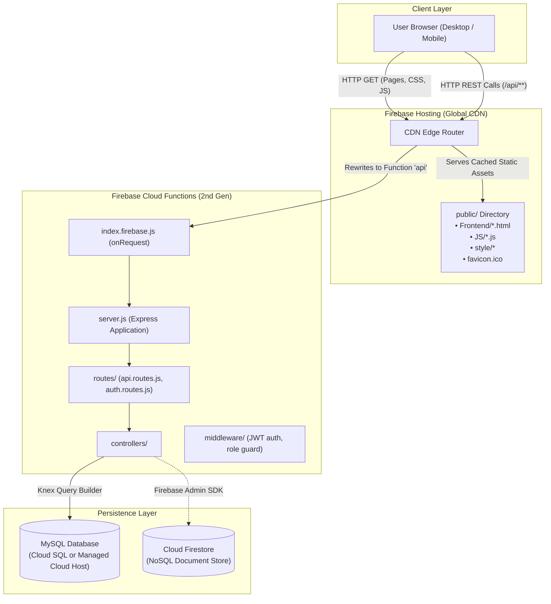

# 📦 PUP PQ-Scheduler: Firebase Deployment Technical Documentation

This document provides a comprehensive technical reference for all code files, modules, npm dependencies, configurations, and architectural components required to deploy the **PUP PQ-Scheduler** system to **Firebase**.

---

## 🏛️ 1. Architecture & Directory Mapping

The application operates as a decoupled full-stack architecture:



### Directory Structure & Deployment Roles

```text
Pupwms2_Casptone_updating/
├── firebase.json                 # Core Firebase Hosting & Functions configuration
├── .firebaserc                   # Firebase project targeting & environment alias
├── index.firebase.js             # Firebase Cloud Functions (2nd Gen) entry point
├── prepare-public.js             # Build automation script preparing public/ assets
├── server.js                     # Express application & API routing
├── Dockerfile                    # Container definition for optional Cloud Run deployment
├── .dockerignore                 # Excludes local files from container builds
├── config/
│   ├── database.js               # Knex.js MySQL client (Cloud SQL / remote SSL / local fallback)
│   └── firestore.js              # Cloud Firestore initialization client via firebase-admin
├── routes/
│   ├── api.routes.js             # Core scheduling, faculty, program, and room API endpoints
│   └── auth.routes.js            # Authentication, JWT issuance, and login endpoints
├── public/                       # Generated by prepare-public.js (Deployed to Firebase Hosting CDN)
│   ├── Frontend/                 # HTML templates
│   ├── JS/                       # Client JavaScript logic (app.common.js, app.modal.js, etc.)
│   ├── style/                    # CSS stylesheets, logos, and ambient assets
│   └── index.html                # Root entry redirect
└── scripts/
    └── migrate-mysql-to-firestore.js # Data migration pipeline from MySQL to Cloud Firestore
```

---

## 📄 2. Inventory of Deployment Code & Configuration Files

### 2.1 [firebase.json](file:///c:/Users/nhico/Downloads/Pupwms2_Casptone_updating/firebase.json)
The central configuration file consumed by the Firebase CLI (`firebase deploy`).
- **Hosting Config**: Points to the `public/` directory.
- **Rewrites Engine**: Automatically routes all requests matching `/api/**` to the 2nd Gen Cloud Function named `api` deployed in `asia-southeast1`.
- **Functions Config**: Directs Firebase to package the root application codebase as a Cloud Function while ignoring local logs, test files, and raw SQL scripts.

```json
{
  "hosting": {
    "public": "public",
    "ignore": [
      "firebase.json",
      "**/.*",
      "**/node_modules/**"
    ],
    "rewrites": [
      {
        "source": "/api/**",
        "function": {
          "functionId": "api",
          "region": "asia-southeast1"
        }
      }
    ]
  },
  "functions": [
    {
      "source": ".",
      "codebase": "pupwms",
      "ignore": [
        "Frontend/**",
        "JS/**",
        "style/**",
        "public/**",
        "reference/**",
        "postman/**",
        "system_excel_format/**",
        ".git/**",
        "node_modules/**",
        "*.sql",
        "*.md",
        "*.txt"
      ]
    }
  ]
}
```

---

### 2.2 [index.firebase.js](file:///c:/Users/nhico/Downloads/Pupwms2_Casptone_updating/index.firebase.js)
The serverless bridge between Google Cloud Functions (2nd Gen) and the Express application:
- Uses `firebase-functions/v2/https` (`onRequest`).
- Imports the modular `server.js` Express instance.
- Deploys in `asia-southeast1` (Singapore region, ~25–35ms latency to Manila/PUP).
- Configures 512 MB memory, 120s execution timeout (sufficient for large Excel imports), and autoscales between 0 and 10 instances.

```javascript
const { onRequest } = require('firebase-functions/v2/https');
const app = require('./server');

exports.api = onRequest({
    region: process.env.FIREBASE_REGION || 'asia-southeast1',
    memory: '512MiB',
    timeoutSeconds: 120,
    minInstances: 0,
    maxInstances: 10,
    cors: true
}, app);
```

---

### 2.3 [prepare-public.js](file:///c:/Users/nhico/Downloads/Pupwms2_Casptone_updating/prepare-public.js)
Build preparation utility that synchronizes static assets into `./public`:
- Recursively copies `Frontend/` HTML files to `public/Frontend/` and mirrors them into `public/` root so direct links like `https://domain.web.app/dashboard.html` resolve cleanly.
- Copies `JS/` and `style/` folders.
- Copies `PUP LOGO.png` as `favicon.ico`.

---

### 2.4 [server.js](file:///c:/Users/nhico/Downloads/Pupwms2_Casptone_updating/server.js) (Modular Export)
Updated to allow dual-mode execution:
1. **Local Mode**: If invoked directly (`node server.js`), it binds to `process.env.PORT || 5002` and listens via HTTP.
2. **Serverless Cloud Function Mode**: If imported via `require('./server')`, it exports the configured `app` without binding to a local TCP socket.

```javascript
// Start Server if run directly
if (require.main === module) {
    const PORT = process.env.PORT || 5002;
    app.listen(PORT, () => {
        console.log(`PUP PQ Workload API server running on port ${PORT}`);
    });
}

module.exports = app;
```

---

### 2.5 [config/database.js](file:///c:/Users/nhico/Downloads/Pupwms2_Casptone_updating/config/database.js)
The Knex database connection layer with dynamic environment detection:
- **Cloud SQL Unix Socket**: If `INSTANCE_UNIX_SOCKET` is provided, connects via the high-speed local IPC socket `/cloudsql/<CONNECTION_NAME>`.
- **Cloud MySQL with SSL**: If `DB_SSL === 'true'`, enables TLS encryption with `rejectUnauthorized: false` for managed hosts (Aiven, Railway, Supabase).
- **Local Fallback**: Connects to `127.0.0.1:3308` with default parameters when no environment variables are specified.

---

### 2.6 [config/firestore.js](file:///c:/Users/nhico/Downloads/Pupwms2_Casptone_updating/config/firestore.js)
Initializes Google Cloud Firestore via the `firebase-admin` SDK:
- Auto-authenticates using Google Application Default Credentials (ADC) inside Cloud Functions and Cloud Run without requiring manual credential JSON files.
- Supports `FIREBASE_SERVICE_ACCOUNT_KEY` path for local debugging.

---

## 📦 3. Complete NPM Module & Dependency Reference

| Package | Version | Deployment Purpose |
| :--- | :--- | :--- |
| **`firebase-admin`** | `^12.0.0` | Official Google server-side SDK. Provides privileged administrative access to Cloud Firestore, Firebase Auth, and Cloud Storage. |
| **`firebase-functions`** | `^5.0.0` | SDK providing 2nd-generation HTTPS and event-driven trigger wrappers for Google Cloud Functions. |
| **`express`** | `^4.19.2` | Core backend HTTP framework handling API routing, middleware chaining, and request lifecycle. |
| **`cors`** | `^2.8.5` | Cross-Origin Resource Sharing middleware enabling secure cross-origin browser requests. |
| **`knex`** | `^3.1.0` | SQL query builder supporting connection pooling, transactions (`trx`), and migration logic for relational tables. |
| **`mysql2`** | `^3.10.1` | High-performance MySQL driver used by Knex for connecting to Cloud SQL or cloud MySQL instances. |
| **`pg`** | `^8.12.0` | PostgreSQL client driver (pre-installed, allows switching Knex `DB_CLIENT` to Postgres if needed). |
| **`dotenv`** | `^16.4.5` | Loads environment configurations from local `.env` files during offline development. |
| **`bcryptjs`** | `^3.0.3` | Cryptographic hashing library used for password encryption and secure verification. |
| **`jsonwebtoken`** | `^9.0.3` | Issues and cryptographically validates HMAC-SHA256 bearer tokens for authenticated API sessions. |
| **`multer`** | `^2.2.0` | Handles multipart/form-data payloads for spreadsheet file uploads in `file-management.html`. |
| **`xlsx`** / **`exceljs`** | `^0.18.5` / `^4.4.0` | Binary spreadsheet parsing engines for extracting faculty profiles, course schedules, and room allocations. |
| **`nodemailer`** | `^10.1.0` | SMTP client communicating with Gmail servers to dispatch workload notifications and password resets. |
| **`@google/genai`** | `^2.24.0` | Google Gemini API SDK for automated scheduling recommendations and AI conflict resolution. |

---

## 🔐 4. Environment Variables & Secret Configuration

When deploying to Firebase Cloud Functions, secrets must not be hardcoded in code. Set them using the Firebase CLI:

```powershell
# Set Database Credentials
firebase functions:secrets:set DB_HOST
firebase functions:secrets:set DB_PORT
firebase functions:secrets:set DB_USER
firebase functions:secrets:set DB_PASSWORD
firebase functions:secrets:set DB_NAME
firebase functions:secrets:set DB_SSL

# Set Email Dispatcher Credentials
firebase functions:secrets:set SMTP_USER
firebase functions:secrets:set SMTP_PASS
firebase functions:secrets:set SMTP_FROM

# Set Security Secrets
firebase functions:secrets:set JWT_SECRET
```

---

## ⚡ 5. Deployment Commands Summary

```powershell
# 1. Install CLI globally
npm install -g firebase-tools

# 2. Authenticate
firebase login

# 3. Associate project
firebase use --add

# 4. Build public assets
npm run build:public

# 5. Deploy all (Hosting + Cloud Functions)
firebase deploy

# 6. Deploy only frontend changes
firebase deploy --only hosting

# 7. Deploy only backend API changes
firebase deploy --only functions
```
