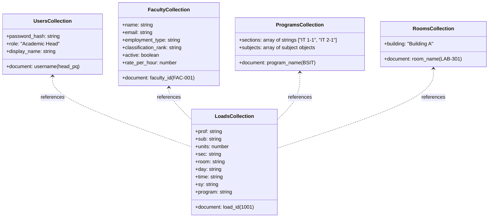

# 🔥 Cloud Firestore Implementation & Migration Guide

This guide explains how to set up, integrate, and utilize **Google Cloud Firestore** (Firebase's native NoSQL document database) for the **PUP PQ-Scheduler** system.

---

## 🎯 1. Overview: MySQL vs. Cloud Firestore

| Feature | Current Setup (MySQL) | Cloud Firestore (NoSQL) |
| :--- | :--- | :--- |
| **Data Model** | Relational tables, rows, foreign keys | Collections of flexible JSON documents |
| **Querying** | SQL queries, complex `JOIN`s, `GROUP BY` | Direct key-value lookups, filtered range queries |
| **Realtime Updates**| Requires polling via `fetch()` intervals | Native live push updates (`onSnapshot`) to UI |
| **Transactions** | ACID multi-table transactions (`trx`) | Document batched writes & atomic transactions |
| **Scaling** | Vertical scaling (CPU/RAM sizing in Cloud SQL) | Automatic horizontal autoscaling by Google |

---

## 🚀 2. Step 1: Enable Firestore in the Firebase Console

1. Navigate to the [Firebase Console](https://console.firebase.google.com/).
2. Select your project (e.g. `pup-pq-scheduler`).
3. In the left sidebar under **Build**, click **Firestore Database**.
4. Click **Create database**.
5. **Location**: Select `asia-southeast1` (Singapore) — this ensures ultra-low latency (<35ms) to Manila and matches your Cloud Functions region.
6. **Security Rules**: Choose **Start in production mode** (or **test mode** for development).
7. Click **Enable**.

---

## 🗂️ 3. Step 2: Mapping MySQL Tables to Firestore Collections

In Firestore, tables become **Collections**, and rows become **Documents**:



### Collection Schemas:

#### 1. `users` Collection
- **Document ID**: `username` (e.g., `head_pq`)
- **Fields**:
  ```json
  {
    "username": "head_pq",
    "password_hash": "$2b$10$...",
    "role": "Academic Head",
    "display_name": "Academic Head",
    "id_number": "EMP-2026-001"
  }
  ```

#### 2. `faculty` Collection
- **Document ID**: `faculty_id` (e.g., `FAC-001`)
- **Fields**:
  ```json
  {
    "id": "FAC-001",
    "name": "Dr. Juan Dela Cruz",
    "email": "jdelacruz@pup.edu.ph",
    "program": "Information Technology",
    "employment_type": "Regular Full-Time",
    "classification_rank": "Associate Professor",
    "active": true,
    "specialization": "Software Engineering, Cloud Computing",
    "preferred_subjects": "Database Systems, Web Development",
    "rate_per_hour": 350.00
  }
  ```

#### 3. `programs` Collection
- **Document ID**: `program_name` (e.g., `Information Technology`)
- **Fields**:
  ```json
  {
    "name": "Information Technology",
    "sections": ["BSIT 1-1", "BSIT 2-1", "BSIT 3-1", "BSIT 4-1"],
    "subjects": [
      {
        "subject_name": "Web Development",
        "year_level": "2nd Year",
        "semester": "1",
        "units": 3.0,
        "lec_units": 2.0,
        "lab_units": 1.0
      }
    ]
  }
  ```

#### 4. `loads` Collection
- **Document ID**: `load_id` (e.g., `1710012345678`)
- **Fields**:
  ```json
  {
    "id": 1710012345678,
    "prof": "Dr. Juan Dela Cruz",
    "sub": "Cloud Computing",
    "sec": "BSIT 3-1",
    "room": "Room 204",
    "building": "Main Building",
    "day": "Monday",
    "time": "08:00 AM - 11:00 AM",
    "units": 3.0,
    "sy": "AY 2025-2026",
    "program": "Information Technology",
    "semester": "2"
  }
  ```

---

## 💻 4. Step 3: Interacting with Firestore in Code

The client is initialized in [config/firestore.js](file:///c:/Users/nhico/Downloads/Pupwms2_Casptone_updating/config/firestore.js).

### 4.1 Fetching All Faculty
```javascript
const { db } = require('./config/firestore');

async function getFacultyList() {
    const snapshot = await db.collection('faculty').where('active', '==', true).get();
    const facultyList = [];
    snapshot.forEach(doc => {
        facultyList.push(doc.data());
    });
    return facultyList;
}
```

### 4.2 Adding or Updating a Schedule Load
```javascript
const { db } = require('./config/firestore');

async function saveLoad(loadData) {
    const docId = String(loadData.id || Date.now());
    await db.collection('loads').doc(docId).set(loadData, { merge: true });
    return { success: true, id: docId };
}
```

### 4.3 Querying Faculty Schedules
```javascript
const { db } = require('./config/firestore');

async function getLoadsByFaculty(facultyName) {
    const snapshot = await db.collection('loads')
        .where('prof', '==', facultyName)
        .where('sy', '==', 'AY 2025-2026')
        .get();
        
    return snapshot.docs.map(doc => doc.data());
}
```

---

## 🔄 5. Step 4: Automated Migration from MySQL to Firestore

An automated migration script has already been built for your repository:
👉 [scripts/migrate-mysql-to-firestore.js](file:///c:/Users/nhico/Downloads/Pupwms2_Casptone_updating/scripts/migrate-mysql-to-firestore.js)

### How to Run the Migration:
1. Ensure your local MySQL server is running (or cloud MySQL is connected in `.env`).
2. Make sure you are logged in to Firebase (`firebase login`).
3. Run the migration script in your terminal:

```powershell
node scripts/migrate-mysql-to-firestore.js
```

### What this script does:
- Extracts all `users`, `faculty`, `rooms`, `programs`, `program_sections`, `program_subjects`, `loads`, and `request_history` from your MySQL database.
- Normalizes relational structures (e.g. bundling curriculum sections and subjects inside each program document).
- Commits records in atomic batches of 400 documents to Cloud Firestore.
- Preserves all IDs and relationships.

---

## 🛡️ 6. Step 5: Recommended Firestore Security Rules

In Firebase Console > **Firestore Database** > **Rules**, paste the following security rules:

```javascript
rules_version = '2';
service cloud.firestore {
  match /databases/{database}/documents {
    
    // Server-side Cloud Functions have full administrative bypass.
    // Client-side web access rules:
    
    // Authenticated users can read faculty and schedules
    match /faculty/{facultyId} {
      allow read: if request.auth != null;
      allow write: if request.auth.token.role == 'Academic Head';
    }
    
    match /loads/{loadId} {
      allow read: if request.auth != null;
      allow write: if request.auth.token.role == 'Academic Head';
    }
    
    match /programs/{programId} {
      allow read: if request.auth != null;
      allow write: if request.auth.token.role == 'Academic Head';
    }
    
    match /rooms/{roomId} {
      allow read: if request.auth != null;
      allow write: if request.auth.token.role == 'Academic Head';
    }
    
    // Only administrators can access users
    match /users/{userId} {
      allow read, write: if request.auth.token.role == 'Academic Head';
    }
  }
}
```

---

## ⚖️ 7. Which Architecture Should You Choose?

### Approach A: Hybrid Model (Recommended for Graduation / Capstone)
- **MySQL / Cloud SQL**: Handles the heavy relational scheduling algorithms, conflict detection, and Excel spreadsheet imports.
- **Firestore**: Used for real-time notifications, instant audit log tracking, and live schedule status updates across connected faculty browsers without needing page reloads.

### Approach B: Full NoSQL Migration
- The entire system migrates to Cloud Firestore using `scripts/migrate-mysql-to-firestore.js`.
- Eliminates the need for any MySQL server or Cloud SQL instance, running 100% serverless within Firebase's free tier.
